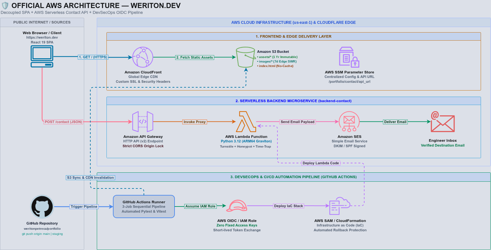
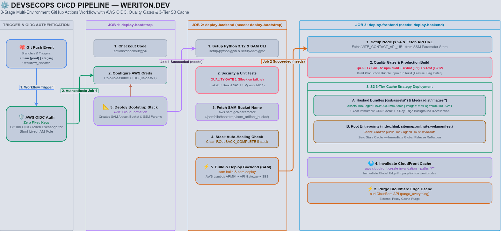

# 🛡️ Forja de Software — Portfolio Fullstack & Cloud Infrastructure

[](https://weriton.dev)
[](https://aws.amazon.com/)
[](https://react.dev/)
[](https://www.typescriptlang.org/)
[](https://docs.github.com/en/actions/deployment/security-hardening-your-deployments/about-security-hardening-with-openid-connect)

> **"Dogfooding de Engenharia de Software:"** Este não é apenas um site estático de apresentação, mas um **produto cloud-native em produção**, projetado e implantado seguindo princípios rígidos de **DevSecOps, Infraestrutura como Código (IaC) Multi-Ambiente, Arquitetura Serverless e Alta Disponibilidade na AWS**.

---

## 📌 Visão Geral & Filosofia de Design

O repositório abriga a aplicação **Fullstack & Serverless** do portfólio de **Weriton Petreca** ([weriton.dev](https://weriton.dev)). O projeto foi concebido para transformar a própria plataforma de apresentação em um **estudo de caso vivo** de arquitetura de software, resiliência e entrega contínua.

### 🎯 Destaques Arquiteturais
* **Arquitetura Desacoplada (Decoupled SPA + Serverless API):** Frontend React superleve servido globalmente via edge locations (CloudFront + S3), consumindo uma API Serverless isolada para eventos de contato.
* **Segurança Zero-Trust / Zero Fixed Keys:** Autenticação entre GitHub Actions e AWS realizada exclusivamente via **AWS OIDC (OpenID Connect)**. Nenhuma chave de acesso fixa (`AWS_ACCESS_KEY_ID`) vive no repositório.
* **Proteção Anti-Spam em Camadas (Cloudflare Turnstile + Honeypot + Time-Trap):** Desafio criptográfico na borda aliado a armadilhas invisíveis que executam *Silent Drop* (`200 OK` sem invocar o Amazon SES) para bots automatizados, economizando cota e custos (FinOps).
* **Release Gating via Feature Flags & Code Splitting:** O módulo experimental **Cloudwardens** (`/cloudwardens`) é isolado via `React.lazy()` e controlado pela feature flag `VITE_ENABLE_CLOUDWARDENS` (`true` em Staging/Dev, `false` em Produção), permitindo evoluir e testar novos produtos em nuvem sem impactar a página profissional em produção.
* **Infraestrutura Multi-Ambiente (`staging` e `prod`):** Isolamento completo de stacks CloudFormation/SAM (`portfolio-backend-contact-staging` e `portfolio-backend-contact-prod`) e parâmetros SSM (`/portfolio/{env}/contact/api_url`).

---

## 🏗️ Arquitetura do Sistema

O **weriton.dev** segue uma arquitetura desacoplada e *serverless-first*, combinando a entrega global de assets estáticos com microsserviços sob demanda na AWS:



---

## 🛠️ Tech Stack & Ferramentas

### **Frontend & UX (`frontend/`)**
* **Core:** React 19.2, TypeScript 6.0, Vite 8.1.
* **Roteamento & SEO:** React Router v7, `react-helmet-async` (Injeção de Metadados e JSON-LD).
* **Estilização & Design System:** Tailwind CSS v4.3, Motion 12.42, Fontes Google.
* **Testes & Qualidade:** Vitest 4.1, Testing Library, Oxlint 1.72 (Linter em Rust).

### **Backend Serverless de Contato (`backend-contact/`)**
* **Runtime:** Python 3.12 executado em arquitetura **ARM64 (AWS Graviton2)** para otimização de custo/performance.
* **Framework IaC:** AWS SAM (Serverless Application Model) / CloudFormation.
* **Serviços AWS:** AWS Lambda (com X-Ray Tracing), Amazon API Gateway HTTP API v2, Amazon SES, AWS SSM Parameter Store.
* **Qualidade & Segurança Backend:** Pytest, Bandit (SAST), Flake8, Black.

---

## 🚀 Pipeline CI/CD Multi-Ambiente (GitHub Actions)

A esteira de entrega contínua (`.github/workflows/deploy.yml`) opera com **GitHub Environments** (`staging` e `production`):
* **Push na branch `staging`:** Implanta a stack `staging` na AWS com `VITE_ENABLE_CLOUDWARDENS=true` para homologação integrada.
* **Push na branch `main`:** Implanta a stack `prod` na AWS com `VITE_ENABLE_CLOUDWARDENS=false`, mantendo apenas o Portfólio Profissional ativo em `https://weriton.dev`.



### **Estratégia de Cache S3 em 3 Camadas:**
1. **Bundles Compilados com Hash (`dist/assets/*`):** `public, max-age=31536000, immutable` (Cache de 1 ano na CDN).
2. **Mídia Estática (`dist/images/*`):** `public, max-age=604800, stale-while-revalidate=86400` (Cache de 7 dias com revalidação transparente na borda para máxima performance de LCP).
3. **Entrypoints e Metadados (`index.html`, `sitemap.xml`, `site.webmanifest`):** `public, max-age=0, must-revalidate` (Atualização imediata a cada release).

---

## 📂 Estrutura do Repositório

```text
.
├── .github/
│   └── workflows/
│       ├── deploy.yml                  # Pipeline CI/CD Multi-Ambiente (staging / prod)
│       └── destroy.yml                 # Workflow para teardown seletivo de stacks AWS
├── backend-contact/                    # Microsserviço Serverless de Contato (AWS SAM + Python)
│   ├── events/
│   │   └── event.json                  # Evento de teste sintético do API Gateway HTTP API v2
│   ├── src/
│   │   └── app.py                      # Função Lambda em Python 3.12 (Graviton2 ARM64)
│   ├── tests/
│   │   └── test_handler.py             # Suíte de testes unitários do backend (Pytest)
│   ├── env.json                        # Mapeamento de variáveis de ambiente para o SAM Local
│   ├── pytest.ini                      # Configuração do executor do Pytest
│   ├── requirements.txt                # Dependências do microsserviço
│   ├── samconfig.toml                  # Perfis de deploy (staging e prod) do AWS SAM CLI
│   └── template.yaml                   # Definição de Infraestrutura Serverless parametrizada
├── frontend/                           # Aplicação Frontend (React 19 + TypeScript + Vite)
│   ├── public/                         # Assets estáticos, ícones, currículo PDF e imagens
│   ├── src/
│   │   ├── components/
│   │   │   ├── layout/                 # Header, Footer, Seo e ScrollToTop
│   │   │   └── ui/                     # Button, Divider, EmbersCanvas, PrivacyModal, TurnstileWidget
│   │   ├── data/                       # Dados estáticos de projetos do portfólio
│   │   ├── lib/
│   │   │   ├── config.ts               # Gerenciamento tipado de Feature Flags (Fail-Closed)
│   │   │   └── contact.ts              # Cliente HTTP para a API Serverless de Contato
│   │   ├── pages/
│   │   │   ├── professional/           # Rota / (Portfólio Profissional)
│   │   │   └── NotFoundPage.tsx        # Tratamento da rota 404 (noindex)
│   │   ├── styles/
│   │   │   └── index.css               # Design System (@theme) em Tailwind CSS v4
│   │   ├── App.tsx
│   │   ├── main.tsx
│   │   └── router.tsx                  # Roteamento declarativo da aplicação
│   ├── tests/                          # Suíte de testes unitários e de integração (Vitest)
│   ├── .env.example                    # Exemplo documentado de variáveis de ambiente
│   ├── index.html                      # Entrypoint HTML com metadados SEO e Open Graph
│   ├── package.json
│   └── vite.config.ts
├── infra/
│   └── bootstrap/
│       └── template.yaml               # Stack CloudFormation de Fundação (Bucket SAM & SSM)
└── README.md
```

---

## 🧪 Como Rodar o Projeto Localmente

### **Pré-requisitos**
* Node.js `24.x` ou superior
* Python `3.12.x` ou superior
* AWS SAM CLI & Docker (opcional, para emular a Lambda localmente)

### **1. Executando o Frontend**

```bash
# Clone o repositório
git clone https://github.com/weritonpetreca/portfolio.git
cd portfolio/frontend

# Instale as dependências
npm ci

# Execute o servidor de desenvolvimento
npm run dev
```

Acesse `http://localhost:5173` no seu navegador.

### **2. Executando Testes e Linters**

```bash
# Testes e Linter do Frontend (Vitest + Oxlint)
cd frontend
npm run lint
npm run test

# Testes do Backend de Contato (Pytest)
cd ../backend-contact
pytest -v
```

---

## ✉️ Contato & Redes Profissionais

* **Portfólio em Produção:** [weriton.dev](https://weriton.dev)
* **LinkedIn:** [linkedin.com/in/weriton-petreca](https://linkedin.com/in/weriton-petreca)
* **Credly (Certificações):** [credly.com/users/weriton-luis-petreca](https://www.credly.com/users/weriton-luis-petreca)
* **WhatsApp:** [Enviar mensagem](https://wa.me/5535997231989?text=Ol%C3%A1%20Weriton,%20vi%20seu%20portf%C3%B3lio!)
